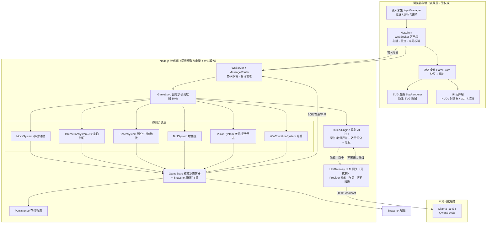
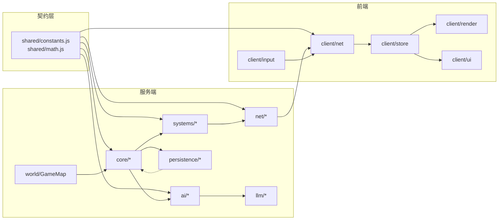
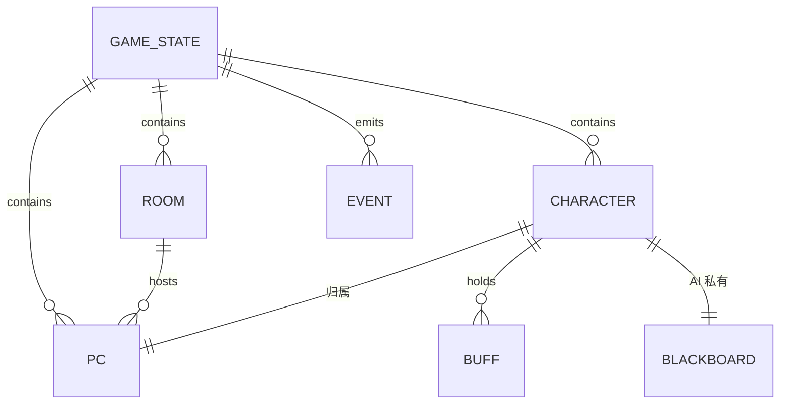
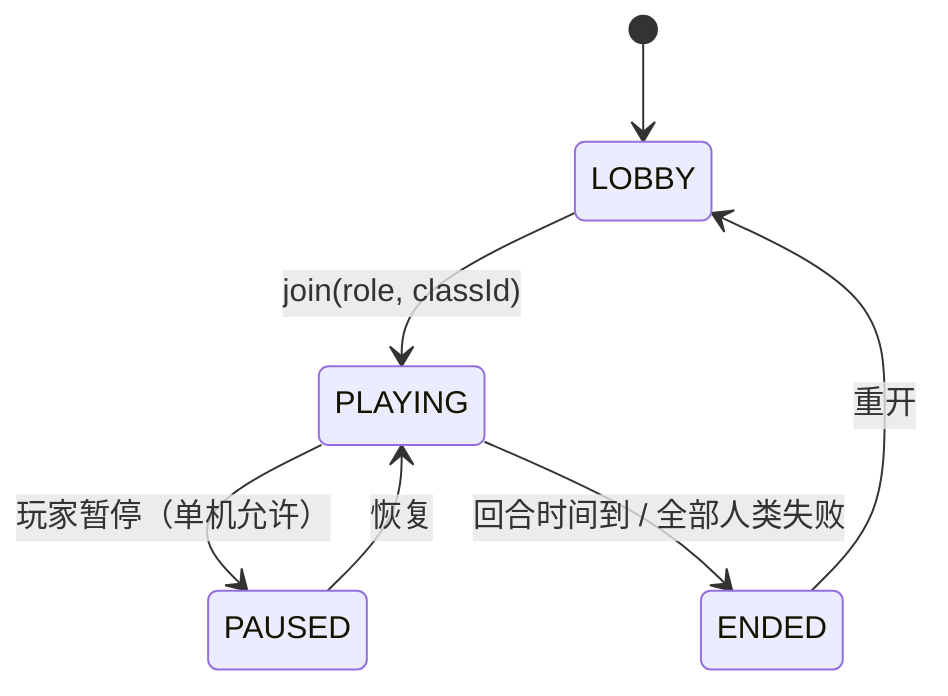
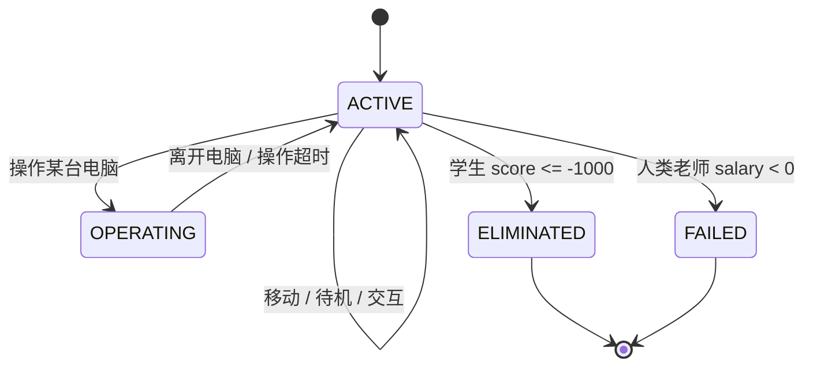
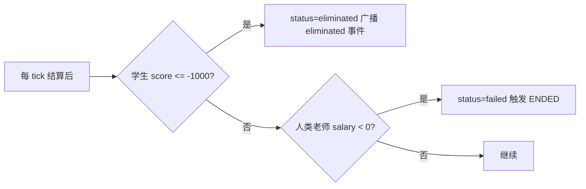
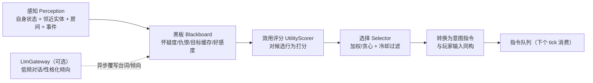
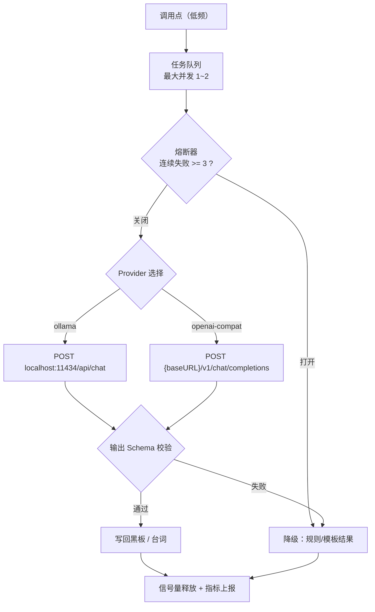
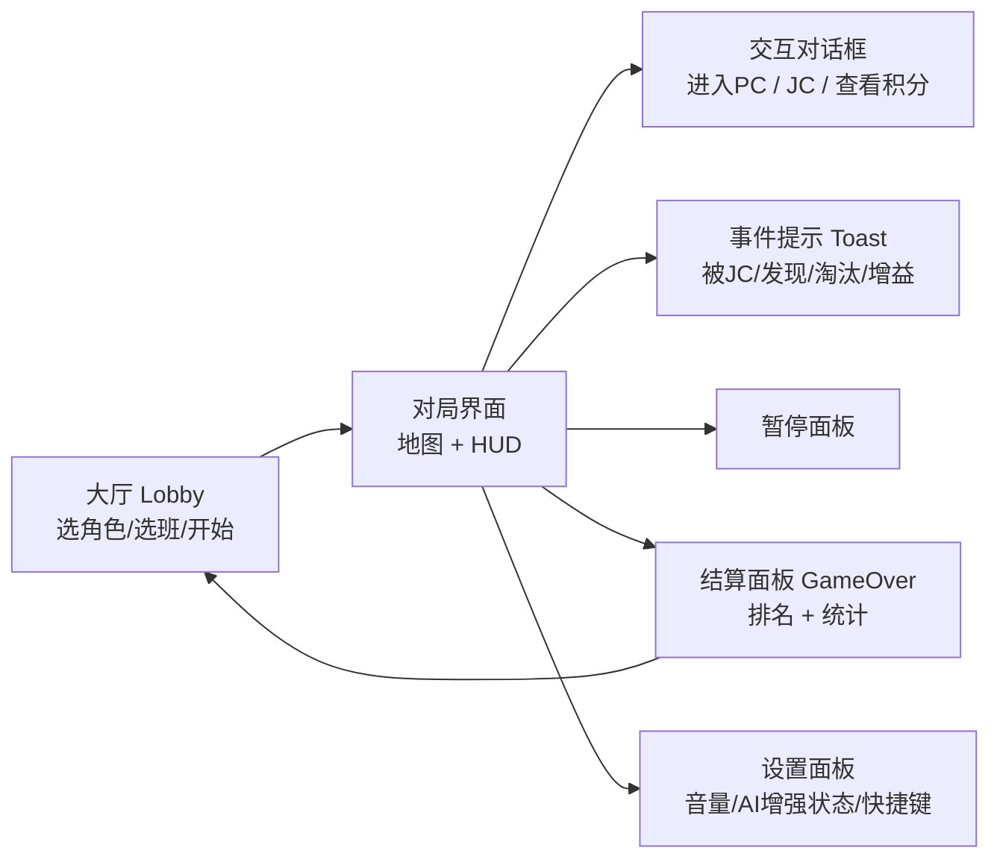

# 机惨模拟器 · 技术方案 v0.0

> 文档版本：**v0.0（Draft / 待评审）**
> 项目代号：`jican-simulator`
> 文档状态：初稿，含 10 项待确认设计假设（见 §1.6）
> 交付范围：**仅技术方案**，v0.0 不含任何游戏源代码
> 适用读者：产品负责人、客户端/服务端开发、测试、后续接手的维护者

***

## 目录

- [0. 术语表](#0-术语表)
- [1. 需求分析](#1-需求分析)
- [2. 总体架构](#2-总体架构)
- [3. 技术栈选型](#3-技术栈选型)
- [4. 项目文件结构](#4-项目文件结构)
- [5. 模块划分](#5-模块划分)
- [6. 核心游戏状态管理](#6-核心游戏状态管理)
- [7. SVG 地图渲染](#7-svg-地图渲染)
- [8. 角色移动与交互逻辑](#8-角色移动与交互逻辑)
- [9. 积分与工资系统](#9-积分与工资系统)
- [10. 规则 AI 决策引擎](#10-规则-ai-决策引擎)
- [11. LLM 调用接口](#11-llm-调用接口)
- [12. 通信协议规范（WebSocket）](#12-通信协议规范websocket)
- [13. 主游戏循环](#13-主游戏循环)
- [14. UI 界面设计](#14-ui-界面设计)
- [15. 部署方案](#15-部署方案)
- [16. 测试与验收](#16-测试与验收)
- [17. 风险评估与对策](#17-风险评估与对策)
- [18. 里程碑与版本路线](#18-里程碑与版本路线)
- [19. 附录](#19-附录)

***

## 0. 术语表

| 术语       | 含义                                         |
| -------- | ------------------------------------------ |
| **JC**   | 本项目核心对抗玩法的代号，即「劫持他人积分」：走到他人电脑前，把目标的积分转移给自己 |
| **PC**   | 地图中的电脑终端（每个学生/老师拥有归属电脑）                    |
| **归属电脑** | 电脑，是查看积分、执行 JC 操作的唯一入口                     |
| **增益区**  | 厕所、聊天室等停留即产生属性加成的区域                        |
| **目击**   | 老师视野范围内捕捉到 JC 行为，触发工资奖励，执行 JC 的人扣除相应积分。    |
| **tick** | 服务端权威逻辑的最小步进单位（默认 100ms）                   |
| **权威端**  | Node.js 服务进程，唯一有权修改游戏状态的实体                 |
| **降级**   | LLM 不可用时自动回落为纯规则 AI 的运行模式                  |

***

## 1. 需求分析

### 1.1 业务目标

构建一个**单机、离线可玩、服务端权威**的多智能体模拟游戏。核心体验是：玩家在校园地图中与 34 个由 AI 驱动的同学/老师共处，围绕「积分获取」与「积分劫持（JC）」展开博弈。

| 目标        | 说明                                 |
| --------- | ---------------------------------- |
| G1 可玩性    | 玩家选择一个角色后即可立即操作，AI 角色行为合理、有对抗感     |
| G2 零外部依赖  | 全部美术资源为原生 SVG 自绘，无需联网、无需第三方素材授权    |
| G3 低资源占用  | 服务端常驻内存目标 < 150 MB（呼应「最小内存占用」偏好）   |
| G4 AI 可插拔 | 规则引擎为决策主体，本地 LLM 为**可选增强**，缺失时无感降级 |
| G5 可调平衡   | 所有数值外置于配置文件，支持热调参与可复现随机            |

### 1.2 玩法需求拆解与模块映射

| 编号  | 需求（源自产品设定）                                       | 落地模块                        | 章节         |
| --- | ------------------------------------------------ | --------------------------- | ---------- |
| R1  | 地图：3 教室（各 10 台电脑）+ 2 厕所 + 1 聊天室 + 1 办公室          | `world/GameMap`             | §7.3       |
| R2  | 角色：30 学生（3 班 × 10）+ 5 老师（3 任课 + 2 常驻）            | `core/GameState`            | §6.1       |
| R3  | 玩家扮演 1 名学生或 1 名老师，其余 AI 控制                       | `net` + `ai`                | §6.3 / §10 |
| R4  | 学生初始 0 分，≤ −1000 失败退队                            | `systems/ScoreSystem`       | §9.1       |
| R5  | 问老师问题：办公室停留 10 秒                                 | `systems/InteractionSystem` | §8.6       |
| R6  | 讨好老师：0\~100 随机                                   | `systems/InteractionSystem` | §8.7       |
| R7  | JC：走近他人电脑 → 进入 → 分享积分 → 输入用户名与数量 x → 目标 −x、自己 +x | `systems/InteractionSystem` | §8.5       |
| R8  | 查看积分必须回自己电脑；操作自己电脑时免疫被 JC                        | `systems/InteractionSystem` | §8.8       |
| R9  | 老师发现 JC +100￥；本班学生被 JC −20￥；工资 <0 人类老师失败；AI 老师无敌 | `systems/ScoreSystem`       | §9.2       |
| R10 | 厕所停留 3 秒速度 +10% 可叠加                              | `systems/BuffSystem`        | §8.9       |
| R11 | 聊天室停留期间全属性 +0.01%/秒                              | `systems/BuffSystem`        | §8.9       |
| R12 | 学生 AI：按积分状态决策问问题/讨好/JC/闲逛                        | `ai/student.behavior`       | §10.2      |
| R13 | 老师 AI：巡逻检测 JC 并处罚                                | `ai/teacher.behavior`       | §10.3      |

### 1.3 技术约束

| 类别   | 约束                                                            |
| ---- | ------------------------------------------------------------- |
| 前端   | 必须为 HTML5 + **原生 SVG** + CSS3；SVG 资源不得依赖第三方图标库                |
| 后端   | Node.js 本地服务，与前端经 WebSocket 通信                                |
| AI   | 本地/自托管模型（Ollama + Qwen2-0.5B 为参考实现），经 `localhost` HTTP API 调用 |
| 运行环境 | Windows 优先（当前开发机），Node ≥ 20                                   |
| 部署形态 | 单机启动，浏览器访问 `http://localhost:5173`                            |
| 网络   | 允许完全离线；LLM 缺失不得阻断游戏                                           |

### 1.4 性能指标（SLO）

| 指标       | 目标          | 备注                             |
| -------- | ----------- | ------------------------------ |
| 逻辑帧率     | 10 Hz 固定步长  | 单 tick ≤ 8 ms（35 角色规模）         |
| 渲染帧率     | 60 FPS      | `requestAnimationFrame` + 位置插值 |
| 首屏可玩     | < 1 s（本地）   | 无构建、无外网请求                      |
| 增量包大小    | 单帧 < 8 KB   | 首帧全量快照 < 200 KB                |
| 服务端内存    | < 150 MB 常驻 | 全内存状态 + 周期快照落盘                 |
| LLM 单次调用 | 超时 2 s      | 异步、绝不阻塞主循环                     |
| 断线重连     | 3 s 内恢复     | 指数退避 + 快照重放                    |

### 1.5 可扩展性要求

1. **地图可扩展**：地图为纯数据（JSON + SVG），新增房间不改代码。
2. **行为可扩展**：AI 行为为「行为单元 + 效用权重」注册表，新增行为只需注册。
3. **Provider 可扩展**：LLM 走 `Provider` 抽象，Ollama / OpenAI 兼容 / 未来远端均可挂载。
4. **角色规模可扩展**：单班人数、班级数、老师数均为配置项，模拟系统按 O(n) 遍历设计。

### 1.6 设计假设与待确认清单 ⚠️

下列项在原始需求中未明确，v0.0 按「建议默认值」设计，**请评审时逐条确认或修正**：

| #   | 待确认问题                                      | 建议默认值                                                                                                     |
| --- | ------------------------------------------ | --------------------------------------------------------------------------------------------------------- |
| Q1  | **胜负条件**：需求只定义了学生失败（≤ −1000），未定义「赢」与「一局结束」 | 采用**回合制**：默认单局 600 s；结束时按积分排名结算。先抵达「目标积分」者提前获胜（可选）                                                        |
| Q2  | **讨好老师**语义：是「奖励学生积分」还是「消耗积分买好感」？是否有失败概率？   | 视为**奖励**：老师随机给 0\~100 分；成功率 40到80%，失败扣 5到40 分（可配）                                                         |
| Q3  | **问老师问题**加分值与频率上限                          | +50 分/次，冷却 30 s，单局上限 10 次                                                                                 |
| Q4  | **JC 目标限制**：是否要求目标积分 > 0？负积分能否被 JC？        | 允许 x ≤ 目标积分；目标积分为负时自然无法 JC（无正数解）                                                                          |
| Q5  | **老师目击判定**：视野形状、距离衰减、是否即时处罚                | 扇形视野半径 260 px、张角 ±60°；半径内命中率随距离线性衰减（近 100% / 远 50%）；即时结算；但是用户可以靠遮掩物（如桌子）挡住老师的视野，同样学生的视野也会被遮挡，被遮挡的视野会显示为黑色 |
| Q6  | **玩家是否计入 35 人**                            | 计入：35 个角色槽位（30 学生 + 5 老师），玩家选择其一，其余 34 个由 AI 驱动                                                           |
| Q7  | **「全属性」的具体维度**（聊天室增益）                      | 移动速度、视野半径、交互速度、积分获取系数                                                                                     |
| Q8  | **厕所 buff 叠加上限**                           | 上限 5 层（+50%）；离场后按配置的半衰期衰减                                                                                 |
| Q9  | **能否查看他人积分**                               | 不能。仅能在自己的电脑上查看自己的积分。但是可以进入他人电脑查看他人积分                                                                      |
| Q10 | **地图尺寸与房间连通关系**                            | viewBox 1920 × 1080，中央走廊串联 3 教室 / 办公室；厕所与聊天室分列走廊两端。详见 §7.3 图                                              |

***

## 2. 总体架构

### 2.1 架构总览



### 2.2 权威模型与数据流

采用 **Server-Authoritative（服务端权威）** 模型，三条原则：

1. **单一真相源**：`GameState` 只存在于服务端内存；前端持有的是**只读镜像**。
2. **输入上行、状态下行**：前端只上报「意图」（方向向量、动作指令），不参与任何数值计算。
3. **表现与逻辑分离**：前端可自由插值、预测，但任何偏离都会被下一帧权威快照纠正。

数据流：`前端输入 → WS → 消息路由 → 写入待处理指令队列 → 下个 tick 消费 → 系统流水线改状态 → 快照/增量/事件下行 → 前端镜像 → 渲染`。

### 2.3 分层职责

| 层   | 位置                              | 职责                | 禁止事项                 |
| --- | ------------------------------- | ----------------- | -------------------- |
| 表现层 | `client/`                       | 渲染、输入、UI、插值       | 不得修改权威数值、不得自行判定命中/结算 |
| 协议层 | `server/net/`、`shared/`         | 消息校验、序列化、会话、重连    | 不含业务规则               |
| 模拟层 | `server/systems/`               | 移动、交互、积分、增益、视野、结算 | 不直接操作网络、不写死数值（读配置）   |
| 决策层 | `server/ai/`                    | 规则 AI、效用评分、黑板     | 不得同步阻塞主循环            |
| 增强层 | `server/llm/`                   | LLM 网关、提示词、降级     | 不得成为关键路径依赖           |
| 数据层 | `server/persistence/`、`config/` | 配置加载、快照落盘         | 不参与实时 tick           |

### 2.4 关键架构决策（ADR 摘要）

| ADR    | 决策                         | 理由                                | 被否方案                              |
| ------ | -------------------------- | --------------------------------- | --------------------------------- |
| ADR-01 | 服务端权威模拟                    | 玩家改前端无法作弊；AI 与玩家同一套规则；LLM 只在服务端调用 | 纯前端模拟（易作弊、无法统一 AI 权威）             |
| ADR-02 | 固定步长 10 Hz 逻辑 + 60 Hz 插值渲染 | 逻辑确定性可复现；渲染顺滑                     | 可变步长（确定性差）                        |
| ADR-03 | 无构建工具（原生 ESM）              | 零构建、首屏快、离线可跑                      | Vite/Webpack（引入构建链与产物体积）          |
| ADR-04 | SVG 分层 + 差分更新              | 原生 SVG 满足约束；DOM 节点复用避免重建抖动        | Canvas 全量重绘（违背 SVG 约束）/ 整树重建（性能差） |
| ADR-05 | LLM 为辅 + 网关降级              | 0.5B 本地模型延迟不确定，必须与主循环解耦           | LLM 主导决策（不可用即崩）                   |
| ADR-06 | 数值全外置 JSON                 | 平衡可热调、可回归                         | 硬编码常量（调参需改码）                      |

***

## 3. 技术栈选型

### 3.1 选型表

| 领域        | 选型                          | 版本             | 理由                        | 备选（未采用）            |
| --------- | --------------------------- | -------------- | ------------------------- | ------------------ |
| 运行时       | Node.js                     | ≥ 20（当前 24.15） | 本地服务、原生 WS 生态成熟           | Deno / Bun         |
| 包管理       | npm                         | ≥ 10           | 零额外工具链                    | pnpm / yarn        |
| 服务端 HTTP  | Node 内置 `node:http`         | 内置             | 只需要静态托管 + WS Upgrade，无需框架 | Express / Fastify  |
| WebSocket | `ws`                        | ^8             | 轻量、无依赖树、低内存               | socket.io（体积大、协议冗） |
| 前端        | HTML5 + 原生 SVG + CSS3       | —              | 需求硬约束                     | React / Vue        |
| 前端模块      | 原生 ES Module                | —              | 免构建、可调试                   | 打包器                |
| 配置        | JSON + 校验器（自研轻量）            | —              | 无依赖                       | ajv（较重）            |
| 持久化       | JSON 快照文件                   | —              | 单机足够                      | SQLite（可选增强）       |
| LLM 客户端   | Node 内置 `fetch`             | 内置             | 直接打 Ollama HTTP API       | axios（不必要）         |
| 测试        | `node:test` + `node:assert` | 内置             | 零依赖                       | Jest / Vitest      |
| 打包（可选）    | `pkg` / `nexe`              | —              | 产出单文件 exe                 | Electron（过重）       |

### 3.2 依赖清单（运行时）

```
生产依赖：ws
开发依赖：（无，测试用 node 内置）
```

> 设计原则：**生产依赖只有 1 个**。这直接服务于「最小内存占用」与「零构建」两个目标。

### 3.3 零构建策略说明

- 前端以 `<script type="module">` 直接加载 `client/js/*.js`，服务端以静态目录方式托管。
- 前后端共享的常量放 `shared/constants.js`，服务端通过 HTTP 暴露 `shared` 路径供浏览器导入，避免构建期重复代码。
- SVG 地图以 `.svg` 文件 + `map.json` 数据双轨：静态结构走 SVG 文件，动态元素（角色/特效/高亮）由渲染器按数据生成。

***

## 4. 项目文件结构

> v0.0 仓库**仅落地** `docs/`、`README.md`、`.gitignore`、`LICENSE` 等规范文件与本文档；下列代码目录为 v0.1 实现蓝图，此处先行定义以固化契约。

```
jican-simulator/
├── .gitignore                       # 忽略 node_modules、data/saves、日志、IDE 文件
├── LICENSE                          # v0.0：All Rights Reserved（后续安全版换 MIT）
├── README.md                        # 项目简介、快速开始、分支策略、文档索引
├── package.json                     # 脚本入口（start/dev/test/lint）、依赖声明
├── package-lock.json
│
├── docs/                            # ★ 文档（v0.0 已落地）
│   ├── 技术方案-v0.0.md              # 本文档（Markdown 源）
│   ├── 技术方案-v0.0.html            # 精美 HTML 版（自包含、原生 SVG 图）
│   ├── protocol/
│   │   └── websocket-protocol.md     # 协议速查（消息表 + 示例）
│   └── assets/                       # 文档内嵌资源
│
├── config/                          # ★ 全外置可调参数（v0.1 落地）
│   ├── default.json                  # 全局：tick、端口、回合时长、失败阈值
│   ├── balance.json                  # 平衡：JC 上限、讨好区间、buff 系数、目击概率
│   ├── llm.json                      # LLM：provider、baseURL、model、超时、熔断阈值
│   └── maps/
│       └── default.json              # 地图静态定义（房间矩形、墙体、电脑坐标）
│
├── shared/                          # 前后端共享（浏览器可直接 import）
│   ├── constants.js                  # 消息类型、角色类型、房间类型、动作枚举
│   └── math.js                       # 向量、距离、扇形判定、插值
│
├── server/                          # ★ Node.js 权威端（v0.1 落地）
│   ├── index.js                      # 入口：启动 HTTP + WS + 加载配置
│   ├── core/
│   │   ├── GameLoop.js               # 固定步长累加器循环
│   │   ├── GameState.js              # 状态容器与实体工厂
│   │   ├── Snapshot.js               # 全量快照 / 增量 diff / 脏标记
│   │   └── Rng.js                    # 可复现伪随机（种子/mulberry32）
│   ├── systems/
│   │   ├── MoveSystem.js             # 输入→速度积分→碰撞→位置
│   │   ├── InteractionSystem.js      # JC / 问问题 / 讨好 / 查看积分
│   │   ├── ScoreSystem.js            # 积分与工资结算、淘汰判定
│   │   ├── BuffSystem.js             # 厕所/聊天室增益与衰减
│   │   ├── VisionSystem.js           # 老师视野、目击概率
│   │   └── WinConditionSystem.js     # 回合结束与排名
│   ├── ai/
│   │   ├── RuleAIEngine.js           # 调度器：按频率驱动行为单元
│   │   ├── Blackboard.js             # AI 记忆（怀疑度、仇恨、目标缓存）
│   │   ├── UtilityScorer.js          # 效用评分与加权选择
│   │   ├── student.behavior.js       # 学生行为库
│   │   └── teacher.behavior.js       # 老师行为库
│   ├── llm/
│   │   ├── LlmGateway.js             # 统一网关：限流/超时/熔断/降级
│   │   ├── providers/
│   │   │   ├── OllamaProvider.js     # /api/tags 健康检查、/api/chat 对话
│   │   │   └── OpenAICompatProvider.js # /v1/chat/completions 兼容
│   │   ├── prompts/                  # 提示词模板（*.md）
│   │   └── schema/                   # 输出 JSON Schema 校验
│   ├── net/
│   │   ├── WsServer.js               # 连接管理、心跳、重连会话恢复
│   │   ├── MessageRouter.js          # 消息分发
│   │   └── Protocol.js               # 消息构造与结构校验
│   ├── persistence/
│   │   ├── ConfigLoader.js           # 配置装载 + 默认值合并 + 校验
│   │   └── SaveManager.js            # 周期快照 / 读写存档
│   └── world/
│       └── GameMap.js                # 地图数据加载、网格化（寻路用）
│
├── client/                          # ★ 前端（v0.1 落地）
│   ├── index.html                    # 唯一页面入口
│   ├── css/
│   │   ├── theme.css                 # 设计令牌：色板/圆角/阴影/字号
│   │   ├── layout.css                # 布局
│   │   └── components.css            # 组件样式（现代风、抗锯齿）
│   ├── js/
│   │   ├── main.js                   # 引导：连接、订阅、启动渲染
│   │   ├── net/NetClient.js          # WS 客户端（重连、心跳、序号）
│   │   ├── store/GameStore.js        # 状态镜像 + 插值缓冲
│   │   ├── render/
│   │   │   ├── SvgRenderer.js        # 主渲染器（差分更新）
│   │   │   ├── layers.js             # 图层管理
│   │   │   ├── sprite.js             # 角色 SVG 生成/朝向
│   │   │   └── effects.js            # JC 连线、飘字、高亮
│   │   ├── ui/
│   │   │   ├── Lobby.js              # 选班/选角色
│   │   │   ├── HudPanel.js           # 顶栏：积分/工资/计时/角色
│   │   │   ├── JcDialog.js           # JC 输入（用户名 + 数量）
│   │   │   ├── ScoreDialog.js        # 查看积分
│   │   │   ├── Toast.js              # 事件提示
│   │   │   └── GameOverPanel.js      # 结算与排名
│   │   └── input/InputManager.js     # 键鼠/触屏 → 方向与动作
│   └── assets/
│       ├── maps/default.svg          # 地图静态层（原生 SVG）
│       └── icons/*.svg               # 自绘 UI 图标（禁止第三方图标库）
│
├── tests/
│   ├── unit/                         # Rng、Buff 叠加、JC 结算、UtilityScorer
│   └── integration/loop.test.js      # 确定性回放：固定种子跑 N tick 断言终态
│
└── scripts/
    ├── dev.js                        # 启动 + 文件监听重启
    └── check-llm.js                  # Ollama 连通性自检
```

***

## 5. 模块划分

### 5.1 模块依赖关系



### 5.2 模块职责与边界

| 模块                          | 输入           | 输出        | 边界约束                     |
| --------------------------- | ------------ | --------- | ------------------------ |
| `core/GameState`            | 配置、地图数据      | 权威状态树     | 只被 systems/ai 修改；对外只读    |
| `core/GameLoop`             | 时间源          | tick 序号   | 不含业务逻辑，只做流水线编排           |
| `core/Snapshot`             | 前一快照、当前状态    | delta 包   | 不感知网络层                   |
| `systems/MoveSystem`        | 待处理输入队列、buff | 新位置、朝向    | 不做碰撞以外的规则判定              |
| `systems/InteractionSystem` | 邻近关系、动作指令    | 交互结果事件    | 数值全部读 `balance.json`     |
| `systems/VisionSystem`      | 位置、朝向、遮挡     | 目击结果      | 纯几何 + 概率，不产生副作用          |
| `ai/RuleAIEngine`           | 状态 + 黑板      | 「意图指令」    | 产出的指令与玩家输入**同构**，走同一执行路径 |
| `llm/LlmGateway`            | 提示词          | 结构化建议（可选） | 异步、可失败、可降级；绝不阻塞 tick     |
| `net/MessageRouter`         | WS 帧         | 校验后的指令    | 只做白名单校验，不做规则判定           |

> **关键约束**：AI 产出的意图必须与玩家输入使用**同一个指令结构**并进入同一队列，这样「AI 与玩家同规则」是结构性保证，而非口头约定。

***

## 6. 核心游戏状态管理

### 6.1 状态模型总览



### 6.2 实体数据字典

#### `GameState`（权威状态根）

| 字段              | 类型             | 说明                                       |
| --------------- | -------------- | ---------------------------------------- |
| `schemaVersion` | int            | 快照兼容性版本                                  |
| `phase`         | enum           | `LOBBY` / `PLAYING` / `PAUSED` / `ENDED` |
| `tick`          | int            | 已执行逻辑帧数（单调递增）                            |
| `elapsedMs`     | int            | 本局已进行毫秒数                                 |
| `roundMs`       | int            | 回合时长（配置，默认 600000）                       |
| `mapId`         | string         | 当前地图 id                                  |
| `seed`          | int            | 本局随机种子（可复现）                              |
| `rooms`         | Room\[]        | 房间列表                                     |
| `pcs`           | Pc\[]          | 电脑列表                                     |
| `characters`    | Character\[]   | 全部角色（含玩家）                                |
| `playerCharId`  | string \| null | 玩家角色 id；未加入为 null                        |
| `eventQueue`    | GameEvent\[]   | 待下行的瞬态事件                                 |
| `ranking`       | RankEntry\[]   | 结束时结算结果                                  |
| `stats`         | obj            | 全局统计（JC 次数/发现次数等）                        |

#### `Room`

| 字段         | 类型               | 说明                                                          |
| ---------- | ---------------- | ----------------------------------------------------------- |
| `id`       | string           | 如 `classroom-1` / `toilet-a` / `chatroom` / `office`        |
| `type`     | enum             | `classroom` / `toilet` / `chatroom` / `office` / `corridor` |
| `name`     | string           | 中文显示名                                                       |
| `rect`     | `{x,y,w,h}`      | 矩形边界（世界坐标）                                                  |
| `classId`  | int \| null      | 教室所属班级                                                      |
| `pcIds`    | string\[]        | 房内电脑                                                        |
| `buffZone` | BuffZone \| null | 增益区定义                                                       |
| `noJc`     | bool             | 是否禁止 JC（如走廊可选）                                              |

#### `BuffZone`

| 字段                | 类型    | 说明                       |
| ----------------- | ----- | ------------------------ |
| `kind`            | enum  | `toilet` / `chatroom`    |
| `dwellMs`         | int   | 厕所：触发一次增益所需停留时长（默认 3000） |
| `perSecondPct`    | float | 聊天室：每秒全属性增量（默认 0.01）     |
| `maxStack`        | int   | 叠加上限（厕所默认 5）             |
| `decayHalfLifeMs` | int\` | 离场衰减半衰期（默认 15000）        |

#### `Pc`

| 字段            | 类型             | 说明                                 |
| ------------- | -------------- | ---------------------------------- |
| `id`          | string         | 如 `pc-c1-03`                       |
| `roomId`      | string         | 所在房间                               |
| `ownerCharId` | string         | 归属角色                               |
| `pos`         | `{x,y}`        | 交互坐标                               |
| `operatorId`  | string \| null | 当前正在操作该 PC 的角色（非 null 即**免疫被 JC**） |
| `lockUntil`   | int\`          | 操作锁到期 tick                         |

#### `Character`

| 字段            | 类型             | 说明                                 |
| ------------- | -------------- | ---------------------------------- |
| `id`          | string         | 唯一 id                              |
| `name`        | string         | 显示名（如「学生-1班-07」）                   |
| `username`    | string         | **JC 认证用的用户名**（唯一，供输入匹配）           |
| `role`        | enum           | `student` / `teacher`              |
| `classId`     | int \| null    | 学生必填；老师为所属班或 null（办公室常驻）           |
| `homePcId`    | string         | 归属电脑 id                            |
| `control`     | enum           | `human` / `ai`                     |
| `pos`         | `{x,y}`        | 当前位置                               |
| `vel`         | `{x,y}`        | 当前速度（px/s）                         |
| `facing`      | float          | 朝向弧度                               |
| `baseSpeed`   | float          | 基础速度（默认 120 px/s）                  |
| `speedMul`    | float          | 速度倍率（buff 汇总）                      |
| `attrMul`     | obj            | 全属性倍率（聊天室累积）                       |
| `buffs`       | Buff\[]        | 增益栈                                |
| `score`       | int            | 学生积分 / 老师工资（￥）                     |
| `status`      | enum           | `active` / `eliminated` / `failed` |
| `dwell`       | obj            | 各增益区累计停留（ms）                       |
| `opLock`      | obj            | 交互锁（`{kind, untilTick}`）           |
| `ai`          | Blackboard     | AI 私有黑板（人类则为空）                     |
| `speech`      | string \| null | 最近一句台词（LLM 或模板生成）                  |
| `speechUntil` | int            | 台词展示截止 tick                        |

#### `Buff`

| 字段           | 类型          | 说明                              |
| ------------ | ----------- | ------------------------------- |
| `kind`       | enum        | `toilet_speed` / `chatroom_all` |
| `stacks`     | int         | 层数                              |
| `value`      | float       | 已生效数值（+10% / +0.01%）            |
| `expireTick` | int \| null | 到期 tick（null 表示靠衰减）             |

#### `GameEvent`

| 字段                     | 类型              | 说明                                                                                                                        |
| ---------------------- | --------------- | ------------------------------------------------------------------------------------------------------------------------- |
| `type`                 | enum            | `jc_success` / `jc_blocked` / `teacher_catch` / `score_changed` / `eliminated` / `buff_gained` / `dialogue` / `round_end` |
| `tick`                 | int             | 发生帧                                                                                                                       |
| `actorId` / `targetId` | string \| null  | 相关角色                                                                                                                      |
| `amount`               | int \| null     | 数值                                                                                                                        |
| `pos`                  | `{x,y}` \| null | 用于前端特效定位                                                                                                                  |
| `text`                 | string \| null  | 展示文案                                                                                                                      |

### 6.3 状态机

#### 游戏阶段机



#### 角色状态机



### 6.4 时间与随机

- **时间基准**：单机无需网络时钟同步，服务端以单调时钟累计 `elapsedMs`，按 `tickRate`（10 Hz）推进 `tick`。
- **随机可复现**：所有随机走 `core/Rng.js`（`mulberry32` + 种子），每个角色持有**独立子流**（`seed = baseSeed ^ hash(charId)`），避免「一个角色多抽一次导致全局序列漂移」。
- **确定性要求**：给定相同 `seed` + 相同输入序列，必须得到相同终态（用于集成测试回放）。

### 6.5 快照与增量

| 机制   | 说明                                |
| ---- | --------------------------------- |
| 脏标记  | 每个实体的可变字段写入时打脏；`Snapshot` 只序列化脏实体 |
| 差异粒度 | 实体级 + 字段级（数值字段只发变化值）              |
| 全量快照 | 加入时、重连时、每 2 s 兜底一次                |
| 序号   | 每包带 `seq`，前端丢弃乱序包；缺失则请求全量         |
| 量化压缩 | 未变字段省略；位置保留 1 位小数；枚举用整数索引         |

### 6.6 持久化

| 项    | 方案                                                 |
| ---- | -------------------------------------------------- |
| 存档时机 | 每 5 s / 回合结束 / 玩家主动暂停时写快照                          |
| 存储位置 | `data/saves/<timestamp>.json`（`.gitignore` 排除）     |
| 配置   | `config/*.json` 随仓库版本化；运行期改动走 `data/override.json` |
| 前端设置 | `localStorage`（音量、快捷键、上次角色）                        |
| 可选增强 | v0.1+ 可接 SQLite 记录历史战绩（当前不引入）                      |

***

## 7. SVG 地图渲染

### 7.1 坐标系

- 世界坐标为**统一像素坐标**，`viewBox = "0 0 1920 1080"`。
- SVG 采用 `preserveAspectRatio="xMidYMid meet"`，窗口任意缩放不改变逻辑坐标。
- 角色位置直接映射到世界坐标，**无相机变换**（单屏可容纳全部 7 个房间）；若后续地图增大，仅需在外层 `<g>` 加 `transform`。
- 图层使用 `<g id="layer-*">` 承载，`pointer-events` 按图层控制（交互层 `none`，UI 层独立 DOM）。

### 7.2 图层结构（自底向上）

| 层     | id              | 内容                 | 更新频率       |
| ----- | --------------- | ------------------ | ---------- |
| L0 背景 | `layer-bg`      | 地板、地板纹理、房间底色       | 静态         |
| L1 墙体 | `layer-walls`   | 墙体、门窗、房间描边         | 静态         |
| L2 区域 | `layer-zones`   | 房间内部阴影、增益区脉冲高亮     | 低频（动画）     |
| L3 电脑 | `layer-pcs`     | 每台 PC 的图标 + 使用中状态环 | 中频（操作状态变化） |
| L4 角色 | `layer-actors`  | 角色剪影、朝向、名字标签       | 高频（每帧插值）   |
| L5 特效 | `layer-fx`      | JC 连线、飘字、目击警示圈     | 事件驱动       |
| L6 覆盖 | `layer-overlay` | 玩家高亮圈、交互提示         | 中频         |

### 7.3 地图布局（默认地图 `default`）

```
viewBox 1920 × 1080
┌──────────────────────────────────────────────────────────────────┐
│  [ 厕所 A ]                                        [ 厕所 B ]     │
│   x:60  y:60   w:220 h:180                         x:1640 y:60    │
│                                                                   │
│  ┌── 办公室 (office) ───────────┐   ┌── 聊天室 (chatroom) ──────┐ │
│  │  x:60  y:300   w:420 h:300   │   │  x:1440 y:300 w:420 h:300 │ │
│  │  常驻老师 ×2 + 归属 PC ×2     │   │  增益：全属性 +0.01%/s     │ │
│  └──────────────────────────────┘   └────────────────────────────┘ │
│                                                                   │
│  ══════════════ 中央走廊 corridor (y:660 h:110, x:0 w:1920) ══════ │
│                                                                   │
│  ┌─ 1 班教室 ─────┐ ┌─ 2 班教室 ─────┐ ┌─ 3 班教室 ─────┐          │
│  │ x:60  y:800     │ │ x:700 y:800    │ │ x:1340 y:800   │          │
│  │ w:540 h:220     │ │ w:540 h:220    │ │ w:540 h:220    │          │
│  │ PC ×10 (2×5)    │ │ PC ×10 (2×5)   │ │ PC ×10 (2×5)   │          │
│  │ 任课老师站位     │ │ 任课老师站位    │ │ 任课老师站位    │          │
│  └─────────────────┘ └────────────────┘ └────────────────┘          │
└──────────────────────────────────────────────────────────────────┘
```

- 每班 10 台 PC 按 2 行 × 5 列 均匀排布，PC 间距 100 px。
- 3 名任课老师各有**站位锚点**与**巡逻路径**（本班教室 ↔ 走廊 ↔ 办公室）。
- 2 名办公室常驻老师固定在办公室，处理「问问题」「讨好」交互。
- 走廊为连通枢纽，也是老师巡逻的高频区域 → 形成「JC 需要挑时机」的张力。

### 7.4 角色 SVG 表示

- 角色为**程序化生成的 SVG 组**：`<g class="actor">` 内含 `<circle>`（身体）+ `<path>`（朝向指针）+ `<text>`（名字/积分气泡）。
- 朝向通过 `transform="rotate(deg, cx, cy)"` 更新，避免重建节点。
- 视觉区分：学生（蓝系，班级色相微调）、老师（橙系）、玩家（外圈金色高亮环）。
- 状态可视化：被 JC 时闪红、增益中显示细小图标、被淘汰置灰并降低不透明度。

### 7.5 增益区可视化

| 区域       | 表现                         |
| -------- | -------------------------- |
| 厕所       | 呼吸式半透明填充 + 停留进度环（3 s 圆环填充） |
| 聊天室      | 缓慢流动的渐变 + 属性累积数值小字         |
| 已获得 buff | 角色脚下图标 + 层数角标              |

### 7.6 渲染性能策略

1. **DOM 节点复用**：角色/PC 的 SVG 节点在初始化时创建一次，仅更新属性（`cx/cy/transform/textContent`），绝不整树重建。
2. **差分更新**：`SvgRenderer` 对比上一帧与当前镜像，仅写变化节点。
3. **离屏裁剪**：屏幕外（视口外）实体暂停动画帧更新。
4. **位置插值**：渲染帧之间对位置做线性插值，逻辑 10 Hz 也能呈现 60 FPS 顺滑移动。
5. **动画走 CSS**：脉冲、呼吸等用 CSS 动画/`transform`，避免 JS 逐帧改属性触发重排。
6. **批量写入**：同帧内多次属性更新合并到一次读写批次，降低 layout thrashing。

### 7.7 视觉规范（响应偏好）

| 项    | 规范                                                                 |
| ---- | ------------------------------------------------------------------ |
| 形状语言 | 统一圆角（卡片 12 px、按钮 8 px、房间内描边圆角）                                     |
| 抗锯齿  | SVG `shape-rendering="geometricPrecision"`；CSS 开启字体平滑              |
| 配色   | 深色主题为主，班级以低饱和色相区分，玩家以金色强调                                          |
| 字体   | 系统无衬线栈（`-apple-system, "Segoe UI", "Microsoft YaHei", sans-serif`） |
| 动效   | 200 ms 缓动，尊重 `prefers-reduced-motion`                              |

***

## 8. 角色移动与交互逻辑

### 8.1 移动模型

```
输入方向向量 dir（归一化）
  → 期望速度 v = dir × baseSpeed × speedMul × attrMul.speed
  → 加速度平滑（accel 900 px/s²，使移动不生硬）
  → 与墙体/家具做圆-矩形碰撞求解（滑动而非卡死）
  → 更新 pos；若位移不为 0 则更新 facing = atan2(dir)
```

| 参数   | 默认           | 配置键                      |
| ---- | ------------ | ------------------------ |
| 基础速度 | 120 px/s     | `balance.move.baseSpeed` |
| 加速度  | 900 px/s²    | `balance.move.accel`     |
| 角色半径 | 14 px        | `balance.move.radius`    |
| 碰撞方式 | 圆 vs AABB 滑动 | —                        |

### 8.2 寻路（AI 专用）

- 地图预生成 **32 px 网格**（`GameMap.buildNavGrid()`），标记可通行格。
- AI 目标为坐标 → **A\*** 求路径 → 输出一串路点；移动系统按路点逐段行走。
- 玩家为直接方向输入，不需要寻路。
- 房间内短距离（< 120 px）直接直线逼近，避免 A\* 开销。

### 8.3 碰撞与房间边界

- 墙体为矩形集合；房间 `rect` 为逻辑归属，门洞以墙体缺口表达。
- 角色不得穿越墙体；走廊与房间通过门洞连通。
- 房间归属判定：点是否落在 `room.rect` 内（用于增益区与 PC 交互归属）。

### 8.4 交互判定

| 判定    | 规则                                                  |
| ----- | --------------------------------------------------- |
| 邻近    | `distance(char, target) ≤ interactRadius`（默认 46 px） |
| 互斥    | 每角色同一时刻只有 `opLock` 一种交互；`opLock.kind` 表示当前动作        |
| 冷却    | 动作结束进入冷却（各动作独立，配置）                                  |
| 服务端判定 | 全部交互结果由服务端在 tick 内计算，前端只发「我想做 X」                    |

### 8.5 JC 完整流程（核心玩法）

**前置条件**

1. 发起者已走到**目标角色的电脑**旁（`distance ≤ interactRadius`）。
2. 目标 PC 的 `operatorId` 为空（即目标**没有正在操作自己的电脑**）→ 否则免疫。
3. 目标 `status === 'active'`。
4. 目标 `score > 0`（否则 `x ≤ score` 无正数解）。

**操作时序**

```mermaid
sequenceDiagram
  participant P as 玩家(前端)
  participant S as 服务端
  participant T as 目标角色
  participant W as 老师AI/视野系统

  P->>S: input.action{kind:'enterPc', pcId}
  S->>S: 校验邻近 + operatorId 为空
  S-->>P: event{pcdialog: enter, ownerName, hint}
  P->>S: input.action{kind:'jc.open', pcId}
  S-->>P: event{jc_dialog: open, maxAmount 暂不返回(防探测)}
  P->>S: jc.commit{selfUsername, amount}
  S->>S: 1) 用户名匹配 → 2) 校验 0<amount<=T.score
  S->>S: 3) T.score-=amount; me.score+=amount
  S->>W: 4) 生成 jc_success 事件并广播位置
  W->>W: 5) 遍历老师视野，按距离/朝向抽样判定目击
  alt 被目击
    W->>S: teacher_catch{teacherId, jcCharId}
    S->>S: 老师 salary += 100; 记录 stats
  end
  S-->>P: event{jc_success: amount, 是否暴露}
  S-->>P: delta(双方 score 变化)
```

**校验要点**

| 校验                | 失败结果                                                   |
| ----------------- | ------------------------------------------------------ |
| 用户名不合法            | `jc_blocked{reason:'username_mismatch'}`，不扣分，进入 1 s 冷却 |
| `amount ≤ 0` 或非整数 | `jc_blocked{reason:'invalid_amount'}`                  |
| `amount > 目标积分`   | `jc_blocked{reason:'exceed_target'}`                   |
| 目标 PC 有人操作        | `jc_blocked{reason:'target_immune'}`                   |
| 超出邻近范围            | `jc_blocked{reason:'out_of_range'}`                    |

> **防探测设计**：JC 对话框**不返回目标当前积分**（呼应 Q9「不能查看他人积分」）。玩家需自行估算，命中上限时服务端拒绝，形成风险博弈。

### 8.6 问老师问题（办公室停留 10 秒）

```
条件：角色处于 office 房内，且与某老师距离 ≤ interactRadius
累积：dwell.askMs += dt
触发：dwell.askMs ≥ 10000 且冷却已过且未达单局上限
结果：score += 50（配置 balance.ask.reward）
重置：dwell.askMs = 0，opLock 冷却 30 s，单局计数 +1
```

- 停留判定按**连续**计时，离开办公室或离开老师范围即归零。
- 前端显示进度环，让「10 秒」这一过程可感知。

### 8.7 讨好老师

```
条件：与老师距离 ≤ interactRadius，opLock 空闲
抽样：r = rng()  成功率 eff = base 0.70（老师好感度可修正）
成功：score += round(rng() * 100)     // 0~100，均匀
失败：score -= 20                     // 惩罚（可配），并可能触发老师「警觉」黑板标记
冷却：15 s
```

- 老师的**好感度**（`Blackboard.favor[charId]`）随成功讨好累积，提高后续成功率、降低「被 JC 时怀疑度」。

### 8.8 查看积分与免疫规则

| 规则      | 实现                                                                 |
| ------- | ------------------------------------------------------------------ |
| 只能看自己积分 | `viewScore` 动作仅在 `pcId === myHomePcId` 时通过                         |
| 查看入口    | 回到自己电脑 → 进入 → 查看积分对话框                                              |
| 免疫      | 操作自己电脑期间，该 PC 的 `operatorId = me` → 任何对该角色的 JC 均返回 `target_immune` |
| 代价      | 操作 PC 期间角色**无法移动**（形成「看分即失机动」的博弈代价）                                |

### 8.9 增益区（BuffSystem）

#### 厕所

```
每帧：若角色位于 toilet 房间内
  dwell.toiletMs += dt
  当 dwell.toiletMs >= 3000:
     stacks = min(stacks + 1, maxStack=5)
     speedMul = 1 + 0.10 × stacks
     dwell.toiletMs -= 3000（余量保留）
离场后：按 decayHalfLifeMs=15000 指数衰减（每半衰期减一层等效值）
```

#### 聊天室

```
每帧：若角色位于 chatroom
  attrMul.speed      *= (1 + 0.0001)^dt   // 0.01%/秒
  attrMul.vision     *= (1 + 0.0001)^dt
  attrMul.interact   *= (1 + 0.0001)^dt
  attrMul.scoreGain  *= (1 + 0.0001)^dt
离场：attrMul 保留（按 Q7/Q8 待确认，默认保留但设上限 1.10）
```

#### Buff 汇总与上限

| 来源  | 影响维度        | 上限         |
| --- | ----------- | ---------- |
| 厕所  | `speedMul`  | +50%（5 层）  |
| 聊天室 | `attrMul.*` | 各 +10%（默认） |

***

## 9. 积分与工资系统

### 9.1 学生积分

| 项     | 规则                                     | 配置键                            |
| ----- | -------------------------------------- | ------------------------------ |
| 初始    | 0                                      | `balance.student.initialScore` |
| 失败阈值  | `≤ −1000` → `status = eliminated`，退出模拟 | `balance.student.failScore`    |
| 问问题   | +50 / 次                                | `balance.ask.reward`           |
| 讨好    | 成功 +0\~100 随机                          | `balance.flatter.min/max`      |
| JC 获得 | +x（x ≤ 目标积分）                           | —                              |
| JC 失去 | −x                                     | —                              |

### 9.2 老师工资

| 触发           | 变化                     | 配置键                                |
| ------------ | ---------------------- | ---------------------------------- |
| 发现学生 JC      | `+100 ￥`               | `balance.teacher.catchReward`      |
| 本班学生被 JC     | `−20 ￥`                | `balance.teacher.classLosePenalty` |
| 人类老师工资 `< 0` | `status = failed`，游戏结束 | —                                  |
| AI 老师        | **无敌**：显示可为负，但不受失败判定   | —                                  |

- 「本班」定义：`teacher.classId === student.classId`；办公室常驻老师 `classId = null`，其管辖学生定义为 `null`（即不承担 −20 惩罚，仅靠目击获利）。
- 老师的失败判定仅对 `control === 'human'` 生效。

### 9.3 淘汰与失败判定



### 9.4 结算与排名

回合结束（时间到 / 人类失败 / 玩家主动结束）时：

- 学生榜：按 `score` 降序（`eliminated` 排末位并标注）。
- 老师榜：按 `salary` 降序。
- 附加统计：JC 成功次数、被 JC 次数、目击次数、增益获取次数。

> ⚠️ 胜负规则（Q1）尚待确认，当前采用「回合制 + 排名结算」。

***

## 10. 规则 AI 决策引擎

### 10.1 总体设计

四段式流水线：**感知 → 黑板 → 效用评分 → 行为选择与执行**。



- **决策频率分层**：高层决策（选目标）每 500 ms；行为微调（路径重算）每 200 ms；移动执行每 tick。
- **同构原则**：AI 输出的 `{kind, targetId, ...}` 与玩家 WS 指令结构完全一致，复用 `InteractionSystem`。
- **无全局最优**：AI 不做全局规划，仅局部效用最大化 + 黑板记忆，保证 O(n·k) 复杂度。

### 10.2 学生 AI 行为库

| 行为              | 触发倾向条件             | 效用要素                | 冷却   |
| --------------- | ------------------ | ------------------- | ---- |
| `ask_question`  | 积分偏低/中等；办公室老师在位    | 奖励期望、往返距离成本         | 30 s |
| `flatter`       | 与老师邻近；积分低          | 成功率 × 期望收益 − 惩罚风险   | 15 s |
| `jc_hunt`       | 积分接近阈值（危险）或高收益目标出现 | 目标积分 × 成功概率 − 被发现代价 | 20 s |
| `view_score`    | 需要确认自身积分（周期性）      | 信息价值 − 机动性代价        | 60 s |
| `farm_toilet`   | 速度不足（躲 JC / 追目标）   | 增益价值 − 时间成本         | —    |
| `farm_chatroom` | 积分安全且有富余时间         | 长期收益 − 机会成本         | —    |
| `idle_wander`   | 无更高效用行为            | 基础探索价值              | —    |

**积分状态驱动（呼应 R12）**：

| 积分区间（默认阈值）           | 主导策略                                                 |
| -------------------- | ---------------------------------------------------- |
| `score > 200`        | 保守：`farm_toilet` / `farm_chatroom` / 偶尔 `view_score` |
| `-400 < score ≤ 200` | 平衡：`ask_question` / `flatter` / 选择性 `jc_hunt`        |
| `score ≤ -400`       | 激进：优先 `jc_hunt`（距离阈值放宽、风险容忍提高）                       |

### 10.3 老师 AI：巡逻与目击

| 行为              | 说明                                          |
| --------------- | ------------------------------------------- |
| `patrol`        | 沿预设巡逻环路游走（本班教室 ↔ 走廊 ↔ 办公室），带停留点             |
| `inspect_pc`    | 随机抽查某台 PC；若发现 `operatorId` 异常（非归属者操作）→ 触发处罚 |
| `chase_suspect` | 黑板中出现高怀疑度学生 → 缩短与其距离                        |
| `reprimand`     | 靠近并处罚（生成 `teacher_catch` 事件）                |

**目击判定（VisionSystem）**

```
对每个老师 T 与每个正在 JC 的角色 C：
  d = distance(T, C)
  若 d > visionRadius(默认 260) → 未目击
  夹角 θ = |角度差(T.facing, 指向 C)| 
  若 θ > halfAngle(默认 60°) → 未目击
  命中概率 p = lerp(1.0, 0.5, d / visionRadius)   // 近处必中，远处五成
  若 rng() < p → teacher_catch：T.salary += 100
```

- 视野半径受 `attrMul.vision` 与墙体遮挡影响（墙体阻挡视线，采用简单线段-矩形相交剔除）。
- 未目击不代表安全：`Blackboard.suspicion[C]` 会因「目标积分骤降」「C 在他人 PC 旁逗留」而上浮，超过阈值触发 `chase_suspect`。

### 10.4 效用函数定义

```
Utility(action) = w_gain × GainNorm
                − w_cost × CostNorm
                − w_risk × RiskNorm
                + w_persona × PersonaBias
                − w_cooldown × CooldownPenalty
```

| 权重           | 含义           | 学生默认           | 老师默认 |
| ------------ | ------------ | -------------- | ---- |
| `w_gain`     | 收益权重         | 1.0            | 1.0  |
| `w_cost`     | 时间/距离成本      | 0.6            | 0.4  |
| `w_risk`     | 风险（被目击/被 JC） | 0.8（危险时降至 0.3） | 0.5  |
| `w_persona`  | 性格倾向         | 0.3            | 0.2  |
| `w_cooldown` | 冷却惩罚         | 0.5            | 0.5  |

- 归一化：`GainNorm/CostNorm/RiskNorm` 各自除以参考量纲（距离 / 最大收益 / 最大损失）落到 \[0,1]。
- 选择器：先过滤冷却未就绪的行为，再对剩余行为取 `softmax(Utility/τ)` 采样（`τ` 即「性格随机度」，非纯贪心，使行为更自然）。

### 10.5 黑板（Blackboard）

| 字段                  | 用途                  |
| ------------------- | ------------------- |
| `suspicion[charId]` | 对该角色的怀疑度（老师用），随时间衰减 |
| `grudge[charId]`    | 仇恨（被 JC 过的角色，可能反击）  |
| `favor[charId]`     | 好感（讨好累积，老师用）        |
| `lastSeen[charId]`  | 最近观察到的位置与积分         |
| `targetCache`       | 当前选定的目标与到期时间        |
| `persona`           | 性格参数（冒险度、耐心、社交性）    |

### 10.6 难度与性格参数

- 每个 AI 角色在开局由 `Rng` 抽取一组性格参数（冒险度 ∈ \[0,1]、耐心、社交性），影响权重与采样温度 `τ`。
- 全局难度档位（简单/普通/困难）通过缩放 `visionRadius`、`p` 衰减斜率、AI 反应延迟实现。

### 10.7 决策预算

| 频率             | 内容           |
| -------------- | ------------ |
| 每 tick（100 ms） | 移动执行、碰撞、交互进度 |
| 每 200 ms       | 路径重算、邻近目标刷新  |
| 每 500 ms       | 高层行为选择（效用评分） |
| 每 2 s          | 黑板衰减与长期偏好重估  |

***

## 11. LLM 调用接口

### 11.1 定位：**为辅**

LLM 在本项目中**不承担任何关键路径决策**。其职责仅限：

1. 生成角色**台词**（问问题、讨好、被 JC 时的情绪化发言）。
2. 对 AI 的**倾向**做语义化微调（如「这个角色今天心情差 → 更激进」），以小幅偏置覆盖效用权重。
3. 生成**回合小结**文案。

> 反例（禁止）：不得用 LLM 计算 JC 数值、不得让 LLM 决定是否命中目击、不得在每 tick 调用。

### 11.2 网关架构



### 11.3 Ollama 接口规范

| 用途   | 方法   | 端点                                | 说明                   |
| ---- | ---- | --------------------------------- | -------------------- |
| 健康检查 | GET  | `http://localhost:11434/api/tags` | 超时 500 ms；判断目标模型是否存在 |
| 对话   | POST | `http://localhost:11434/api/chat` | 请求体见下                |

```jsonc
// POST /api/chat  请求
{
  "model": "qwen2:0.5b",
  "messages": [{ "role": "system", "content": "..." },
               { "role": "user", "content": "..." }],
  "stream": false,
  "format": "json",              // 强制 JSON 输出，便于 schema 校验
  "options": { "temperature": 0.8, "num_predict": 64 }
}
```

> 关键参数：`format: "json"` 让 0.5B 模型也能稳定输出结构化结果；`num_predict` 限制长度以控延迟；`stream: false` 简化解析。

### 11.4 OpenAI 兼容接口

```
POST {baseURL}/v1/chat/completions
Headers: Authorization: Bearer {apiKey}
Body: { model, messages, response_format:{type:"json_object"}, max_tokens, temperature }
```

用于对接任何 OpenAI 兼容的本地/自托管服务（如 LM Studio、vLLM）。**默认关闭**，由 `config/llm.json` 决定启用哪个 provider。

### 11.5 提示词与输出校验

- 提示词模板放 `server/llm/prompts/*.md`，含 `{{占位符}}` 插值。
- 每个模板对应一份 JSON Schema（`server/llm/schema/*.json`）。
- 流程：`渲染模板 → 调用 → JSON.parse → 校验 → 通过则使用，失败则降级`。
- 校验失败**必须静默降级**到模板化结果，绝不抛错到主循环。

示例输出契约（台词场景）：

```json
{ "speech": "老师，这道题我真不会……", "moodDelta": -0.1 }
```

### 11.6 限流 / 超时 / 熔断 / 降级矩阵

| 机制   | 参数                         | 行为                           |
| ---- | -------------------------- | ---------------------------- |
| 健康检查 | 启动时 500 ms 超时              | 失败 → `enabled=false`，进入纯规则模式 |
| 单次超时 | 2000 ms（`AbortController`） | 超时 → 该任务降级                   |
| 并发上限 | 1（0.5B 本地模型）               | 超出入队；队列满则丢弃最旧任务              |
| 熔断阈值 | 连续 3 次失败                   | 打开熔断 60 s，期间不发请求             |
| 半开探测 | 熔断到期后 1 次试探                | 成功则关闭熔断，失败则继续打开              |
| 降级目标 | 台词模板 / 中性倾向                | 与 LLM 结果同结构，无缝替换             |
| 指标   | 成功率、延迟 P50/P95、降级次数        | 输出到日志与调试面板                   |

### 11.7 触发点清单（低频）

| 场景        | 频率上限                      | 是否必需 |
| --------- | ------------------------- | ---- |
| 学生提问台词    | 每角色每 60 s 一次              | 否    |
| 讨好台词      | 每角色每 60 s 一次              | 否    |
| 被 JC 反应台词 | 每次 JC 事件（每人每 30 s 最多 1 条） | 否    |
| 回合小结文案    | 回合结束 1 次                  | 否    |
| 性格倾向刷新    | 开局 1 次 + 每 2 分钟 1 次       | 否    |

### 11.8 可观测性

- `/debug/llm-status`（本地调试端点）：返回 `{enabled, provider, model, healthy, circuit, metrics}`。
- 前端设置面板显示「AI 增强：已启用 / 已降级（原因）」徽标，让玩家明确当前模式。

***

## 12. 通信协议规范（WebSocket）

### 12.1 连接生命周期

| 阶段 | 行为                                                     |
| -- | ------------------------------------------------------ |
| 握手 | `ws(s)://localhost:5173/ws`，Upgrade 后服务端下发 `welcome`   |
| 加入 | 客户端 `join` → 服务端校验 → 全量 `snapshot` + `phase`           |
| 心跳 | 客户端每 5 s `ping`，服务端 `pong`；15 s 无心跳判定掉线                |
| 重连 | 指数退避（0.5s/1s/2s/4s/8s，上限 8 s）；带 `lastSeq` 请求增量补发，缺失则全量 |
| 关闭 | 客户端主动 `leave`；服务端释放 AI 接管该角色（人类角色转为 AI 或移除）            |

### 12.2 消息信封

```jsonc
{
  "v": 1,                 // 协议版本
  "type": "input.action", // 消息类型（白名单）
  "seq": 128,             // 客户端上行序号（服务端下行序号独立空间）
  "ts": 1750000000000,    // 毫秒时间戳
  "payload": { }          // 类型相关负载
}
```

### 12.3 C→S 消息表

| type           | payload                        | 说明                                                                    |
| -------------- | ------------------------------ | --------------------------------------------------------------------- |
| `hello`        | `{clientVersion}`              | 版本协商                                                                  |
| `join`         | `{role, classId, characterId}` | 选择并加入角色                                                               |
| `leave`        | `{}`                           | 退出本局                                                                  |
| `input.move`   | `{dir:{x,y}, seq}`             | 方向向量（归一化，服务端再校验）                                                      |
| `input.action` | `{kind, pcId?, targetId?}`     | `kind ∈ {enterPc, leavePc, askQuestion, flatter, viewScore, jc.open}` |
| `jc.commit`    | `{selfUsername, amount}`       | 提交 JC                                                                 |
| `set.speed`    | `{mult}`                       | 单机倍速（0.5/1/2）                                                         |
| `pause`        | `{on}`                         | 暂停/恢复（单机允许）                                                           |
| `ping`         | `{}`                           | 心跳                                                                    |

### 12.4 S→C 消息表

| type       | payload                                          | 说明                                                     |
| ---------- | ------------------------------------------------ | ------------------------------------------------------ |
| `welcome`  | `{protocolVersion, tickRate, mapId, serverTime}` | 握手确认                                                   |
| `phase`    | `{phase, roundMs}`                               | 阶段变化                                                   |
| `snapshot` | `{tick, seq, state}`                             | 全量状态                                                   |
| `delta`    | `{tick, seq, entities, removed}`                 | 增量                                                     |
| `event`    | `GameEvent`                                      | 瞬态事件（特效/飘字/对话框指令）                                      |
| `dialog`   | `{kind, ...}`                                    | 服务端驱动的对话框指令（如 `jc.open` / `jc_blocked` / `score_view`） |
| `error`    | `{code, message, refSeq}`                        | 错误                                                     |
| `gameover` | `{reason, ranking, stats}`                       | 结算                                                     |
| `pong`     | `{}`                                             | 心跳应答                                                   |

### 12.5 错误码

| code           | 含义         |
| -------------- | ---------- |
| `E_PROTO`      | 协议版本不符     |
| `E_BADMSG`     | 消息结构非法     |
| `E_NOTJOINED`  | 未加入即发指令    |
| `E_OUTOFRANGE` | 交互超出范围     |
| `E_IMMUNE`     | 目标处于免疫状态   |
| `E_USERNAME`   | JC 用户名不匹配  |
| `E_AMOUNT`     | JC 数量非法或超限 |
| `E_COOLDOWN`   | 冷却中        |
| `E_ELIMINATED` | 角色已淘汰      |

### 12.6 示例序列（JC 成功）

```
C→S  join          {role:"student", classId:1, characterId:"s1-07"}
S→C  snapshot      {tick:0, seq:1, state:{...}}
C→S  input.move    {dir:{x:0,y:1}, seq:1}
... (多帧移动)
C→S  input.action  {kind:"enterPc", pcId:"pc-c1-04", seq:40}
S→C  dialog        {kind:"enterPc", pcId:"pc-c1-04", ownerName:"学生-1班-04"}
C→S  input.action  {kind:"jc.open", pcId:"pc-c1-04", seq:41}
S→C  dialog        {kind:"jc.open", pcId:"pc-c1-04"}
C→S  jc.commit     {selfUsername:"s1-07", amount:120, seq:42}
S→C  event         {type:"jc_success", actorId:"s1-07", targetId:"s1-04", amount:120, pos:{x:820,y:900}}
S→C  delta         {tick:512, seq:87, entities:[{id:"s1-07", score:120},{id:"s1-04", score:80}]}
S→C  event         {type:"teacher_catch", actorId:"t-c1", targetId:"s1-07", amount:100}
```

***

## 13. 主游戏循环

### 13.1 固定步长循环（累加器模式）

```
const STEP = 1000 / tickRate;   // 100 ms
let acc = 0, last = now();
function frame() {
  const dt = now() - last; last = now();
  acc += dt * speedMult;
  let guard = 0;
  while (acc >= STEP && guard++ < 5) {   // 防雪崩：单帧最多补 5 步
    step(STEP);
    acc -= STEP;
  }
  render();                               // 前端侧
  requestAnimationFrame(frame);           // 前端
}
```

- **防雪崩守卫**：进程被抢占后不追补过多 tick，避免卡顿放大。
- 服务端循环用 `setInterval`（或 `setTimeout` 递归）驱动，与前端 `rAF` 解耦。

### 13.2 系统执行顺序（帧流水线）

```
step(dt):
  1. 消费输入队列      → 校验并写入角色的待执行意图
  2. AI 决策（按频率）  → 产生 AI 意图，与玩家意图并入同一队列
  3. MoveSystem         → 加速度、碰撞、位置更新、朝向
  4. InteractionSystem  → 处理进入/离开 PC、JC、提问、讨好、查看积分
  5. BuffSystem         → 厕所/聊天室停留累积与衰减
  6. VisionSystem       → 老师视野目击判定（读取本帧 JC 结果）
  7. ScoreSystem        → 结算积分/工资、淘汰与失败判定
  8. WinConditionSystem → 回合结束检查
  9. Snapshot           → 计算 delta
 10. 广播节拍           → 按节拍下发 delta + 事件
 11. Persistence        → 按周期写快照
```

> **顺序不可随意调换**：`VisionSystem` 必须在 `InteractionSystem` 之后（才有本帧 JC 结果），`ScoreSystem` 必须在 `VisionSystem` 之后（工资结算依赖目击结果）。

### 13.3 网络广播节拍

| 内容    | 节拍                   |
| ----- | -------------------- |
| delta | 每 tick（10 Hz）        |
| 事件    | 产生即发（合并入当帧包）         |
| 全量快照  | 每 2 s 兜底 / 加入时 / 重连时 |

### 13.4 暂停 / 倍速 / 结束

- 单机允许暂停（`phase = PAUSED`），暂停时 `step` 不执行、心跳继续。
- 倍速通过 `speedMult` 缩放累加器（0.5× / 1× / 2×），AI 与 LLM 频率同步缩放。
- 结束时冻结状态，下发 `gameover`。

### 13.5 主循环职责边界

| 做               | 不做           |
| --------------- | ------------ |
| 编排系统执行顺序        | 不含任何具体规则     |
| 计时、节拍、广播        | 不直接改实体字段     |
| 异常隔离（单系统抛错不崩整局） | 不处理网络 I/O 细节 |

***

## 14. UI 界面设计

### 14.1 信息架构



### 14.2 布局（对局界面）

```
┌──────────────────────────────────────────────────────────┐
│ HUD 顶栏：角色名 | 积分/工资 | 倒计时 | 倍速 | ⏸ | 关闭 ✕ │
├──────────────────────────────────────────────────────────┤
│                                                          │
│              SVG 地图视口（原生 SVG 图层）                 │
│         ┌──────── 增益区高亮 / 角色 / 特效 ────────┐        │
│                                                          │
│                                                          │
├──────────────────────────────────────────────────────────┤
│ 底部状态条：当前房间 | buff 图标 | 交互提示（按 E 进入）    │
└──────────────────────────────────────────────────────────┘
```

- 顶栏右侧**必须有结束/关闭按钮**（呼应「关闭按钮结束游玩」的偏好），点击后弹出确认 → 结算 → 停止该局。
- 窗口尺寸偏好**较小窗口**：默认 960 × 600 逻辑尺寸，可最大化；地图按 `meet` 自适应缩放。

### 14.3 视觉设计令牌（`theme.css`）

| 令牌                 | 值                            | 说明           |
| ------------------ | ---------------------------- | ------------ |
| `--bg-base`        | `#12151c`                    | 主背景（深色）      |
| `--bg-panel`       | `#1b2030`                    | 面板           |
| `--radius-card`    | `12px`                       | 卡片圆角         |
| `--radius-btn`     | `8px`                        | 按钮圆角         |
| `--radius-pill`    | `999px`                      | 胶囊/进度条       |
| `--accent-player`  | `#ffcf5c`                    | 玩家金色强调       |
| `--accent-student` | `#5aa9ff`                    | 学生蓝          |
| `--accent-teacher` | `#ff9f45`                    | 老师橙          |
| `--danger`         | `#ff5c6c`                    | 危险/被 JC      |
| `--ok`             | `#4fd18b`                    | 成功/增益        |
| `--shadow-1`       | `0 6px 18px rgba(0,0,0,.35)` | 浮层阴影         |
| `--ease`           | `cubic-bezier(.22,1,.36,1)`  | 统一缓动（200 ms） |

- 全部圆角、柔和阴影、抗锯齿（`-webkit-font-smoothing: antialiased`）。
- 图标为**自绘 SVG**（禁止第三方图标库），按钮显示图标而非字母。

### 14.4 交互反馈

| 事件      | 反馈                                      |
| ------- | --------------------------------------- |
| JC 成功   | 双方飘字（+x / −x）+ 连线动画 + 目标闪红              |
| 被老师发现   | 红色警示圈 + 顶栏工资跳动 + Toast「被 t-c1 发现！+100￥」 |
| 学生淘汰    | 角色置灰淡出 + Toast                          |
| 获得 buff | 脚下图标淡入 + 层数角标                           |
| 交互可执行   | 角色头顶出现「E」提示气泡                           |
| LLM 降级  | 设置面板徽标变灰，「AI 增强已降级」一次性 Toast            |

### 14.5 关键界面线框

**JC 对话框**（呼应 R7 的四步流程）

```
┌──────── JC —— 分享积分 ────────┐
│ 目标：学生-1班-04 的电脑         │
│                                 │
│ 你的用户名  [s1-07__________]   │
│ 分享数量 x  [ 120 ]   (≤ 对方积分)│
│                                 │
│ ⚠ 无法查看对方当前积分，请自行估算 │
│                                 │
│        [ 取消 ]   [ 确认分享 ]   │
└─────────────────────────────────┘
```

**查看积分对话框**（仅自己电脑可开）

```
┌──────── 我的积分 ────────┐
│  学生-1班-07             │
│  当前积分： 120           │
│  距离淘汰线： −1000        │
│  [ 关闭 ]                │
└──────────────────────────┘
```

### 14.6 快捷键

| 键                  | 动作                  |
| ------------------ | ------------------- |
| `W/A/S/D` / `↑↓←→` | 移动                  |
| `E` / `空格`         | 交互（进入 PC / 提问 / 讨好） |
| `J`                | 在 PC 界面打开 JC        |
| `V`                | 在自己电脑查看积分           |
| `Esc`              | 关闭对话框 / 暂停          |
| `Tab`              | 显示/隐藏统计面板           |
| `+/-`              | 倍速调整                |

***

## 15. 部署方案

### 15.1 环境要求

| 项       | 要求                                           |
| ------- | -------------------------------------------- |
| 操作系统    | Windows 10/11（优先）、macOS、Linux                |
| Node.js | ≥ 20（当前开发机 24.15.0）                          |
| 浏览器     | Chrome / Edge 最新版（原生 ESM + SVG 支持）           |
| 可选      | Ollama（≥ 0.1.x）+ 模型 `qwen2:0.5b`，**缺失不影响运行** |

### 15.2 开发 / 运行流程

```bash
# 安装依赖
npm install

# 启动（服务端 + 静态前端，同端口）
npm start              # → http://localhost:5173

# 开发模式（文件监听自动重启）
npm run dev

# 单元 + 集成测试
npm test

# （可选）LLM 连通性自检
node scripts/check-llm.js
```

### 15.3 端口与目录

| 用途          | 端口/路径                            |
| ----------- | -------------------------------- |
| HTTP + 静态资源 | `5173`（呼应「访问 localhost:5173」偏好）  |
| WebSocket   | 同端口 `ws://localhost:5173/ws`     |
| Ollama（可选）  | `11434`（默认，可配置）                  |
| 存档目录        | `data/saves/`（运行时生成，已 gitignore） |

### 15.4 配置管理

- 优先级：`config/default.json` ← `config/balance.json` ← `data/override.json`（运行时覆盖）。
- 合并策略：浅合并 + 白名单字段校验；非法值回退默认并记日志。
- 所有可调数值必须可在不改代码的前提下调整（呼应 ADR-06）。

### 15.5 可选打包为单文件 exe

| 方案             | 说明                                                   |
| -------------- | ---------------------------------------------------- |
| `pkg` / `nexe` | 将 Node 服务与 `client/`、`config/` 一并打入单 exe，双击启动并自动开浏览器 |
| 注意             | 需把 `client/`、`config/` 作为**资源**打包（非内联），并在运行时解压/读取    |
| 定位             | v0.0 不实现，仅列为 v0.2 的可选交付形态（呼应「.exe 直接下载」偏好）           |

***

## 16. 测试与验收

### 16.1 测试分层

| 层   | 内容                                                   | 手段          |
| --- | ---------------------------------------------------- | ----------- |
| 单元  | Rng 可复现性、Buff 叠加与衰减、JC 结算边界、UtilityScorer 归一化、扇形视野判定 | `node:test` |
| 集成  | 固定种子 + 预设输入脚本跑 N tick，断言终态（确定性回放）                    | `node:test` |
| 协议  | 消息结构校验、错误码覆盖、重连补发                                    | 脚本化 WS 客户端  |
| 端到端 | 浏览器手测关键流程（进入 PC → JC → 被发现 → 工资变化 → 结算）              | 手动/自动化浏览器   |
| 性能  | 35 角色满负载单 tick 耗时、内存占用、包体积                           | 压测脚本        |

### 16.2 验收标准（v0.1 实现期的 DoD）

1. 单 tick 逻辑耗时 ≤ 8 ms（35 角色 + 全系统）。
2. 服务端常驻内存 < 150 MB。
3. 断线 3 s 内恢复且状态一致。
4. 无 Ollama 环境下完整可玩，日志明确标注「LLM 已降级」。
5. 所有 §1.6 待确认项均已由产品确认并落入 `config/balance.json`。
6. 给定种子 + 输入序列可复现同一终态。

***

## 17. 风险评估与对策

| #   | 风险                | 概率 | 影响 | 对策                                               |
| --- | ----------------- | -- | -- | ------------------------------------------------ |
| R1  | LLM 不可用 / 延迟高     | 高  | 中  | 网关降级 + 熔断 + 并发限 1；关键路径零依赖（§11）                   |
| R2  | 本地 0.5B 模型输出不稳定   | 高  | 低  | `format:"json"` 强约束 + Schema 校验 + 模板兜底           |
| R3  | 数值失衡（易刷分/必失败）     | 中  | 高  | 数值全外置 + 可复现回放便于快速调参（§15.4）                       |
| R4  | 35 角色 AI 性能压力     | 中  | 中  | 分层决策频率 + O(n·k) 局部效用 + 网格 A\* + 离屏裁剪（§10.7/§7.6） |
| R5  | SVG 大量 DOM 节点导致掉帧 | 中  | 中  | 节点复用 + 差分更新 + CSS 动画 + 插值（§7.6）                  |
| R6  | 玩家作弊（改前端）         | 低  | 中  | 服务端权威（ADR-01），前端无任何数值计算权                         |
| R7  | 需求歧义导致返工          | 中  | 高  | §1.6 待确认清单先行评审，确认后再进入 v0.1 编码                    |
| R8  | 权益/合规（素材授权）       | 低  | 中  | 全部 SVG 自绘、无第三方图标库/音频素材（§1.3）                     |
| R9  | 单机存档损坏            | 低  | 中  | 周期快照 + 原子写入（写临时文件后 rename）                       |
| R10 | 端口被占用（5173/11434） | 低  | 低  | 启动自检 + 回退端口 + 明确日志                               |

***

## 18. 里程碑与版本路线

| 版本           | 目标       | 交付物                                                   |
| ------------ | -------- | ----------------------------------------------------- |
| **v0.0（当前）** | 技术方案定稿   | 本 Markdown + HTML 方案书；Git 仓库规范文件；**零游戏代码**            |
| v0.1         | 可玩最小闭环   | 状态管理 + SVG 地图 + 移动/交互 + 规则 AI + 主循环 + 基础 UI（LLM 降级运行） |
| v0.2         | AI 增强与打磨 | LLM 网关接入 + 目击/怀疑度细化 + 结算统计 + 打包 exe（可选）               |
| v0.3         | 内容与平衡    | 性格系统、难度档位、多地图、成就与历史战绩                                 |

***

## 19. 附录

### 19.1 关键常量与默认值总表

| 常量              | 默认值                      | 配置键                                           |
| --------------- | ------------------------ | --------------------------------------------- |
| 逻辑帧率            | 10 Hz                    | `tickRate`                                    |
| 回合时长            | 600000 ms                | `round.durationMs`                            |
| 世界尺寸            | 1920 × 1080              | 地图视图常量                                        |
| 学生初始积分          | 0                        | `student.initialScore`                        |
| 学生失败阈值          | −1000                    | `student.failScore`                           |
| 老师发现奖励          | +100 ￥                   | `teacher.catchReward`                         |
| 本班被 JC 惩罚       | −20 ￥                    | `teacher.classLosePenalty`                    |
| 基础速度            | 120 px/s                 | `move.baseSpeed`                              |
| 加速度             | 900 px/s²                | `move.accel`                                  |
| 角色半径            | 14 px                    | `move.radius`                                 |
| 交互半径            | 46 px                    | `interact.radius`                             |
| 厕所触发时长          | 3000 ms                  | `toilet.dwellMs`                              |
| 厕所每层加成          | +10%                     | `toilet.stepPct`                              |
| 厕所叠加上限          | 5 层                      | `toilet.maxStack`                             |
| 厕所衰减半衰期         | 15000 ms                 | `toilet.decayHalfLifeMs`                      |
| 聊天室每秒加成         | +0.01%                   | `chatroom.perSecondPct`                       |
| 提问停留时长          | 10000 ms                 | `ask.dwellMs`                                 |
| 提问奖励 / 冷却       | +50 / 30 s               | `ask.reward` / `ask.cooldownMs`               |
| 讨好区间 / 成功率 / 惩罚 | 0\~100 / 70% / −20       | `flatter.*`                                   |
| 老师视野半径 / 张角     | 260 px / ±60°            | `teacher.visionRadius` / `visionHalfAngleDeg` |
| 目击概率衰减          | 100% → 50%（随距离）          | `teacher.catchProbabilityLerp`                |
| HTTP/WS 端口      | 5173                     | `server.port`                                 |
| Ollama 端点       | `http://localhost:11434` | `llm.baseURL`                                 |
| LLM 模型          | `qwen2:0.5b`             | `llm.model`                                   |
| LLM 单次超时        | 2000 ms                  | `llm.timeoutMs`                               |
| 熔断阈值 / 时长       | 3 次 / 60 s               | `llm.circuit.*`                               |

### 19.2 术语与缩写

| 缩写  | 全称                           | 含义          |
| --- | ---------------------------- | ----------- |
| JC  | —                            | 劫持他人积分的玩法代号 |
| ADR | Architecture Decision Record | 架构决策记录      |
| SLO | Service Level Objective      | 服务等级目标      |
| DoD | Definition of Done           | 完成的定义       |
| RNG | Random Number Generator      | 随机数发生器      |

### 19.3 变更记录

| 版本   | 日期         | 说明                                                            |
| ---- | ---------- | ------------------------------------------------------------- |
| v0.0 | 2026-10-17 | 初稿：需求分析、架构、状态管理、SVG 渲染、移动交互、积分工资、规则 AI、LLM 接口、协议、主循环、UI、部署、风险 |

***

> **下一步**：请评审 §1.6「设计假设与待确认清单」（Q1–Q10）。确认后即可进入 v0.1 编码阶段；如有修正，本文档与 HTML 版将同步更新。

